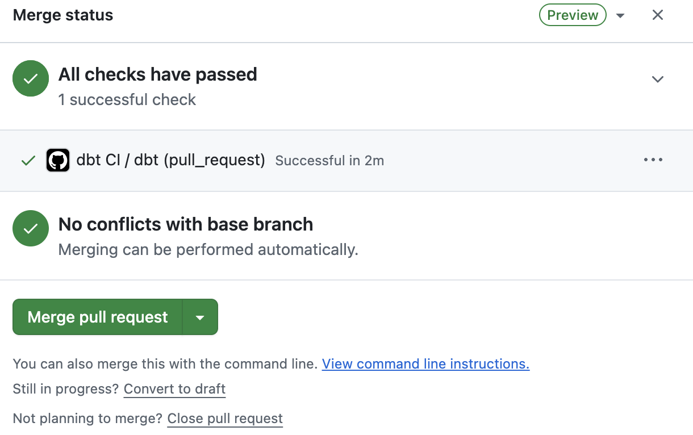
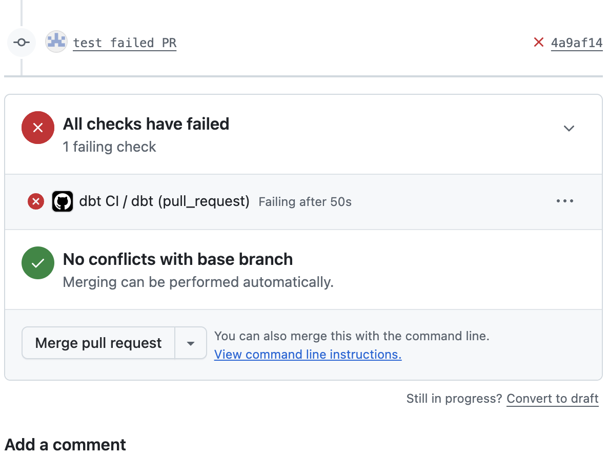

# payments-analytics-dbt

A dbt project modelling card payments data (merchants, terminals, transactions, refunds, chargebacks, FX rates) on DuckDB.

## Getting started

    git clone https://github.com/aakanksha1500/payments-analytics-dbt.git
    cd payments-analytics-dbt
    python3 -m venv .venv
    source .venv/bin/activate
    pip install -r requirements.txt
    dbt debug
    
## Naming conventions
- Models are prefixed by layer: `stg_` (staging), `int_` (intermediate), `dim_` and `fct_` (marts).
- All names are snake_case.
- Keys end in `_id` (or `_key` for keys built from several columns), timestamps in `_at`, dates in `_date`, money in `amount`.
- Columns added by the pipeline rather than the source start with an underscore (`_source_file`).
- One staging model per source table, named `stg_<table>`. Staging only renames, casts, standardises and deduplicates: no joins and no business logic.

## Data quality

Every problem planted by the generator, and the test that catches it.

| Planted problem | Count | Caught in raw data by | Fixed in | Proven by |
|---|---|---|---|---|
| Duplicate transaction ids | 1,074 | `unique` on source, warn | `stg_transactions` (keeps first arrival) | `unique` on `stg_transactions`, error |
| Late-arriving transactions | 3,981 | `expression_is_true` lateness ≤ lookback, error | `fct_transactions` lookback window | `assert_fct_transactions_is_complete`, error |
| Null terminal ids | 611 | `not_null` on `stg_transactions`, warn above 0, error above 2,000 | Excluded from refund rate in marts | |
| Refunds larger than the payment | 15 | `expect_column_pair_values_A_to_be_greater_than_B`, warn | Flagged `is_over_refund` | Stored failures match the manifest ids |
| Merchant tier changes | 30 | | `merchants_snapshot`, `dim_merchant` | One current version, no overlaps; 229 versions = 200 + 30 − 1 |

Found by tests but not planted:
- The currency seed only contained EUR (relationship test to the seed, 41,620 rows).
- Five manifest duplicates that were never written (unique test count disagreed with the manifest).
- No FX rate for the first weekend (EUR singular test, 940 rows).

## CI

Every pull request runs `.github/workflows/dbt-ci.yml` on a clean machine: SQL lint (sqlfluff), a small generated dataset, the merchant snapshot replay, `dbt build` with every test and contract, and `mf validate-configs`. `main` is protected: a PR can only merge when the check passes.

A passing PR:

A PR that removes deduplication from stg_transactions, caught by the unique test:

